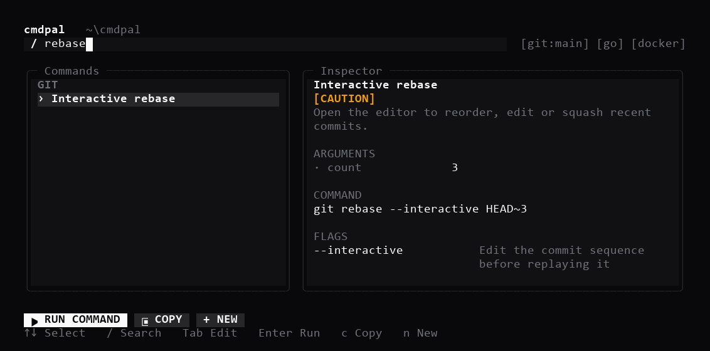

# cmdpal

A command palette for your terminal. Find a command, inspect its flags, and fill in the arguments before you run it.



## Install

Download the archive for your OS and CPU from [GitHub Releases](https://github.com/Hike-12/Codex-5-TUI/releases), then put `cmdpal` or `cmdpal.exe` on your `PATH`. Releases include SHA-256 checksums.

To build from this checkout with Go 1.24 or newer:

```sh
go install .
```

Add the directory printed by `go env GOBIN` to your `PATH`. When it is empty, use the `bin` directory under `go env GOPATH`.

The module is `github.com/Hike-12/cmdpal`. Once the module is published at that path, install it with:

```sh
go install github.com/Hike-12/cmdpal@latest
```

## Use

Run `cmdpal` in any project directory. Git, Node, Go, Rust, Docker, Python, and Make markers pin relevant recipes above the catalog. Recent Bash, Zsh, and PowerShell history can also move matching recipes to the top.

| Action | Keyboard | Mouse |
| --- | --- | --- |
| Filter recipes | `/`, then type | Click the search bar |
| Choose a recipe | Up or Down | Click a recipe or scroll the list |
| Edit an argument | Tab or Shift+Tab | Click its field |
| Cycle live suggestions | Ctrl+Space in a field | |
| Read more of the inspector | Page Up or Page Down | Scroll over the inspector |
| Copy the command | `c` from the list | **Copy** |
| Run the command | Enter | **Run Command** |
| Save a custom command | `n` from the list | **New** |
| Go back or quit | Esc, or `q` from the list | |

The inspector explains the command, previews your arguments, and marks it **Safe**, **Caution**, or **Destructive**. Destructive recipes ask for confirmation. When you run a command, cmdpal restores the terminal, prints the command, and gives it your terminal input and output. It also records it in the shell history file when one is known. Shells can reload disk history at different times.

The app uses PowerShell on Windows when available and your `$SHELL` on macOS and Linux. Recipes use tools such as Git, Docker, curl, and ffmpeg, which must be available on your `PATH`. On Linux, clipboard access uses `wl-copy`, `xclip`, or `xsel`.

## Custom commands

The first run creates `~/.cmdpal/commands.yaml` with an example. Use **New** for a quick entry, or edit the YAML to add defaults, flag descriptions, and a Windows variant.

```yaml
commands:
  - name: Search Git history
    command: git log --oneline -n {{count}}
    summary: Show the latest commits with one line per commit.
    safety: SAFE
    defaults:
      count: "10"
    flags:
      - name: --oneline
        description: Show the short hash and subject.
      - name: -n
        description: Limit the number of commits.
```

Write a placeholder where a shell argument belongs and leave it unquoted. cmdpal quotes the value for the selected shell. Omitted safety levels use `CAUTION`.

## Release

A `v*` tag runs the tests on Windows, macOS, and Linux before GoReleaser publishes archives for amd64 and arm64.

```sh
git tag v0.1.0
git push origin v0.1.0
```
